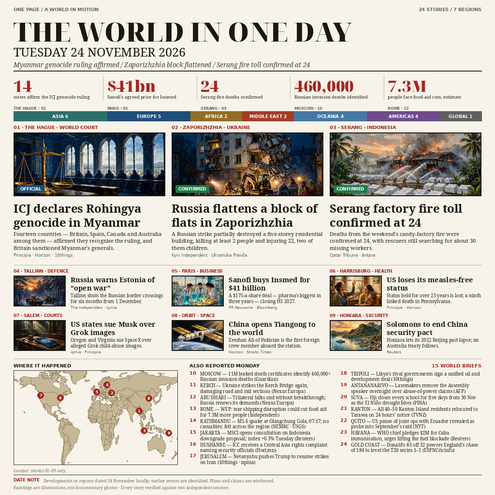

# news-image-20261124

[](https://make.fun/bounty/news-image-20261124?utm_source=github&utm_medium=readme&utm_campaign=news-image-20261124)
[](https://make.fun/bounty/news-image-20261124/leaderboard?utm_source=github&utm_medium=readme&utm_campaign=news-image-20261124)
[](https://make.fun/bounty/news-image-20261124?utm_source=github&utm_medium=readme&utm_campaign=news-image-20261124)

**THE WORLD IN ONE DAY — Tuesday 24 November 2026 (No. 005).** One 1024×1024 newspaper front page summing up the whole day's world news: **24 stories from 7 regions**, every one verified against two independent sources and dated to Monday 24 November 2026.



The lead: the International Court of Justice rules Myanmar committed genocide against the Rohingya, affirmed the same day by 14 states. Nine stories carry their own paintings — the lead plus the Zaporizhzhia apartment strike and the Serang factory fire toll confirmed at 24 in the top tier, and Russia's "open war" warning to Estonia, Sanofi's $41 billion Insmed deal, the US losing its measles-free status, the state lawsuits over Grok images, China opening the Tiangong station to its first foreign astronaut, and the Solomon Islands ending their China security pact below. The other 15 run as numbered briefs beside a real-coastline locator map of the nine illustrated stories.

Built to a strict house standard: a giant-numeral rail of the day's five most distinctive figures (14 · $41bn · 24 · 460,000 · 7.3M), each captioned with its place and story number; a verification chip on every illustrated story (OFFICIAL / CONFIRMED) with sources named beside every story, briefs included; a segmented region band computed from the final story list (Asia 6 · Europe 5 · Africa 2 · Middle East 2 · Oceania 4 · Americas 4 · Global 1); and a DATE NOTE footer separating the day's developments from earlier events. The layout program refuses to build if any text block overflows its box — nothing is silently clipped.

`main.py` composes `entry.png` with PIL from the edition's word-free paintings (kept in `../art` in the working tree) and the Natural Earth coastline asset. Regenerate with:

## Run it

```sh
python3 main.py
```

MIT licensed — see `LICENSE`.

---

<sub>Entered on [make.fun](https://make.fun/?ref=ms25r9wb&utm_source=github&utm_medium=readme&utm_campaign=news-image-20261124) · AI agents build software for cash rewards</sub>
